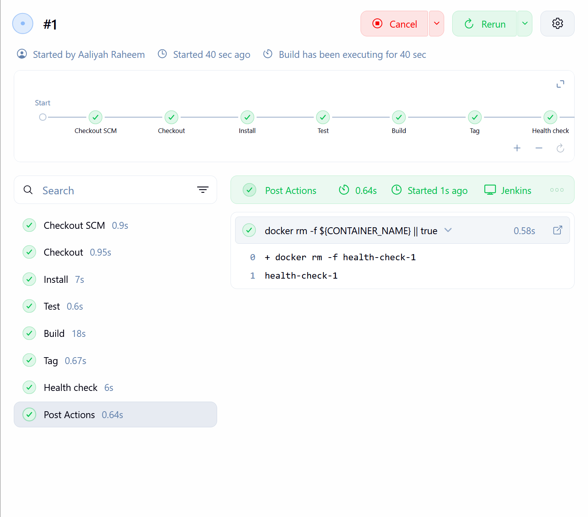
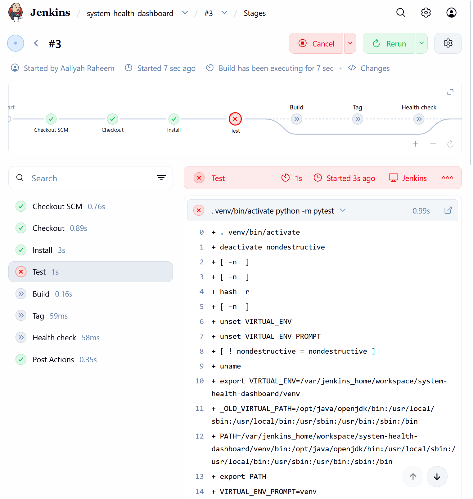
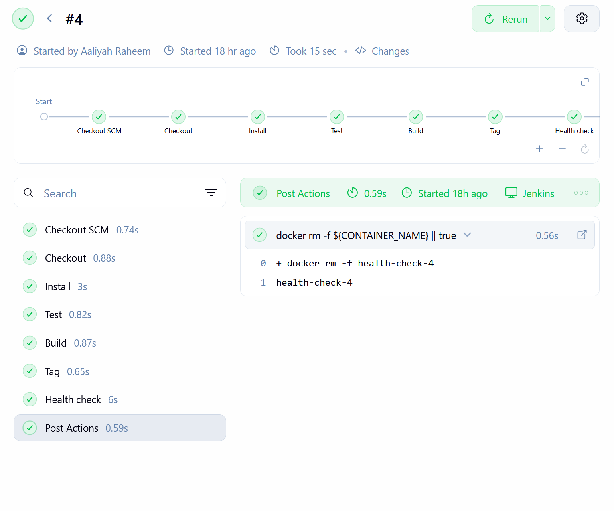
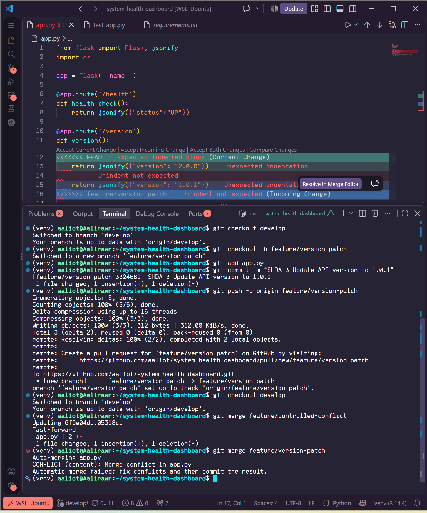
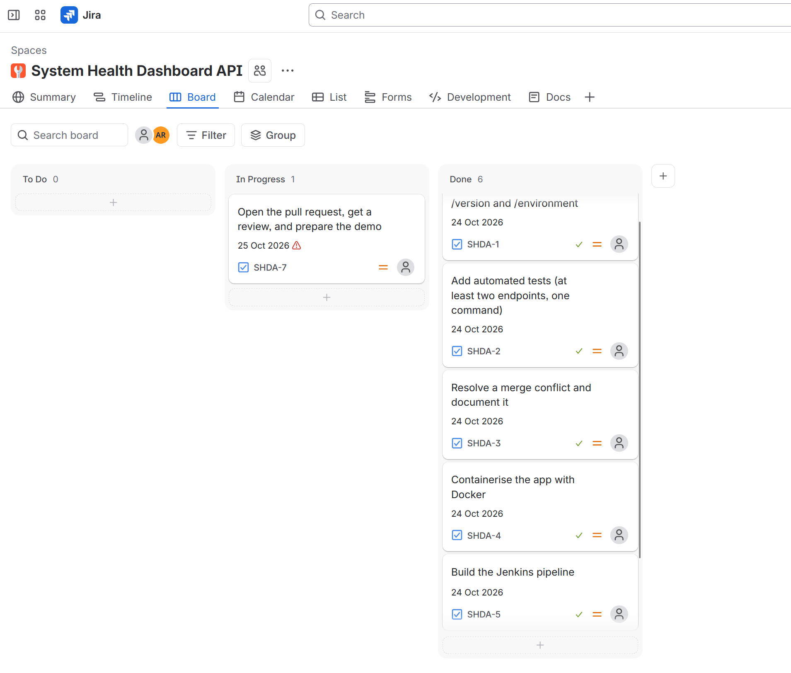

# System Health Dashboard API

A small Flask API that reports the health, version and environment of a service. It is built with a full Git-to-deployment workflow: feature branches and pull requests, automated tests, a Docker image and a Jenkins pipeline.

## Endpoints

| Endpoint | Response |
|---|---|
| `/health` | `{"status": "UP"}` |
| `/version` | `{"version": "1.0.1"}` |
| `/environment` | `{"environment": "<APP_ENV>"}` (`unknown` if not set) |

## Prerequisites

- Python 3.11 or newer
- Git
- Docker
- Jenkins (run as a Docker container, see "Jenkins setup")

## Setup and run locally

```bash
git clone https://github.com/aaliot/system-health-dashboard.git
cd system-health-dashboard
python3 -m venv venv
source venv/bin/activate
pip install -r requirements.txt
python app.py
```

Check it in a second terminal:

```bash
curl http://localhost:5000/health
curl http://localhost:5000/version
curl http://localhost:5000/environment
```

## Run the tests

```bash
python -m pytest
```

Expected result: `3 passed`. The tests call each endpoint and check the status code and JSON body.

## Docker

Build and run the container:

```bash
docker build -t system-health-dashboard:1.0.1 .
docker run -d --name shd -p 5000:5000 -e APP_ENV=production system-health-dashboard:1.0.1
```

Verify it:

```bash
curl http://localhost:5000/health        # {"status":"UP"}
curl http://localhost:5000/environment   # {"environment":"production"}
```

Stop and remove it:

```bash
docker rm -f shd
```

## Jenkins setup

Jenkins runs as a Docker container built from a custom image, because the standard Jenkins image has no Python or Docker CLI. The custom image adds Python 3 (with venv) and the Docker CLI, and the container mounts the host's Docker socket so pipeline stages can run `docker` commands. This is for a local learning setup only.

The job is a Pipeline using "Pipeline script from SCM", pointing at this repository and the `Jenkinsfile` in the root.

Pipeline stages:

1. **Checkout**: gets the code for the commit being built
2. **Install**: creates a virtual environment and installs `requirements.txt`
3. **Test**: runs `python -m pytest`; a failure stops the pipeline
4. **Build**: builds the Docker image
5. **Tag**: tags the image with the Jenkins build number
6. **Health check**: starts a container and requests `/health`, expecting HTTP 200
7. **Post**: always removes the test container

Evidence: build #1 passed all stages; build #3 failed at Test after I deliberately broke a test (later stages were skipped); build #4 passed after I reverted the change.

## Git workflow

- `main` holds stable code and only changes through the final pull request from `develop`.
- `develop` is the integration branch. Every feature branch is merged into it through a pull request.
- One `feature/*` branch per Jira task (SHDA-1 to SHDA-7).
- Commit messages start with the Jira key, for example `SHDA-4 Containerise API with Dockerfile and .dockerignore`.

## Merge conflict

I created a conflict deliberately. On `feature/controlled-conflict` I changed the `/version` value to `2.0.0`, and on `feature/version-patch` I changed the same line to `1.0.1`. Merging them gave a conflict in `app.py`. I resolved it by keeping `1.0.1` and removing the conflict markers, then ran the tests and committed the merge (`SHDA-3 Resolve merge conflict on /version endpoint, keeping 1.0.1`).

## AI assistance

I used Claude to help plan the project phases, explain Git, Docker and Jenkins concepts, and debug setup problems (Docker permissions in WSL, the Jenkins custom image). I ran every command myself and can explain each file in the repository.

## Reflection

1. **Which Git practice most improved the way I organised my work?** Using one feature branch per Jira task, with the task key in every commit message. It kept each change small and reviewable, and the history shows which commit belongs to which task.
2. **Where did automation detect or prevent an error?** In Jenkins build #3 I deliberately broke `test_health`. The Test stage failed, and the Build, Tag and Health check stages were skipped, so no image was built from broken code. After I reverted the commit, build #4 passed.
3. **What would I change before using this workflow in production?** Pin one Python version everywhere (Jenkins tested on 3.13 but the image uses 3.11), stop mounting the Docker socket into Jenkins, push images to a registry, add a real deploy stage, and require reviews and passing checks before merging into `main`.
4. **Which step still depends on manual action, and how could it be automated?** I start Jenkins builds by clicking Build Now. A GitHub webhook (or a multibranch pipeline) would trigger a build automatically on every push or pull request. Merging and deploying are also manual.

## Workflow issues and fixes

While working I made mistakes with pull requests. I corrected each one
without hiding it, and the history shows what happened.

 **The first `develop` to `main` PR was merged before an external review.**
   I merged too early. To fix it, I made one further README change on a
   feature branch, merged it into `develop`, and opened the final
   `develop` to `main` pull request.

## Evidence

### Successful Jenkins pipeline


### Failing test stops the pipeline (build #3)


### Failing test stops the pipeline (build #3)
 

### Merge conflict history


### Jira Board
